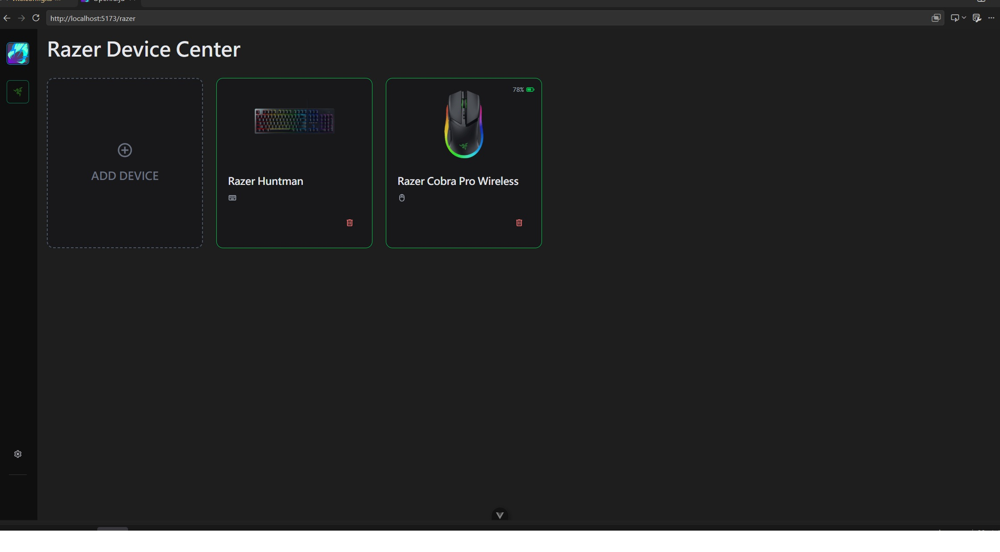
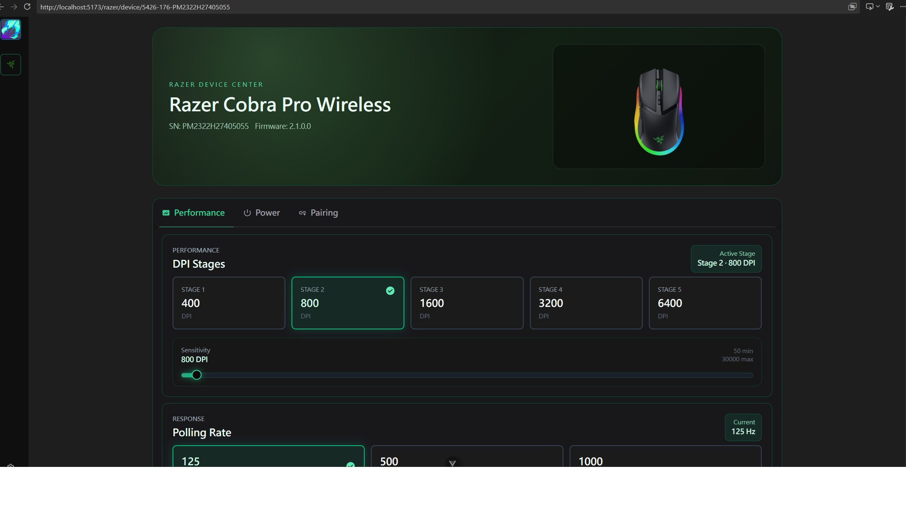

# Openraiju - Razer WebHID Controller

A simple web-based controller for Razer devices, built with Vue, UnoCSS, and the WebHID API.

## Screenshots





## Tech Stack

- [Vue](https://vuejs.org/)
- [UnoCSS](https://unocss.dev/)
- [WebHID API](https://developer.mozilla.org/en-US/docs/Web/API/WebHID_API)

## Getting Started

```bash
pnpm install
pnpm run dev
```

Open the local URL provided by Vite in your browser.

## Usage

1. Connect your compatible Razer device.
2. Open the project in a WebHID-compatible browser.
3. Grant permission to access your device when prompted.
4. Use the interface to control supported features.

## Notes

- Requires a browser that supports the WebHID API.
- Device compatibility and available features depend on the implementation.
- WebHID generally requires a secure context, such as HTTPS or localhost.

## License

MIT
